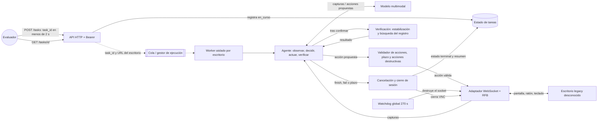

# agent screen — System Design

<!-- Documento vivo: lo construyes respondiendo las preguntas de /design. Las marcas section:… las usan las skills del kit: no las borres; los títulos sí se pueden retocar. -->

## Requisitos
<!-- section:requirements -->
<!-- Funcionales: qué hace el sistema y para quién (verbos). No funcionales, con número: latencia, disponibilidad, consistencia, durabilidad, seguridad. -->

**Problema.** Una empresa necesita operar sistemas legacy sin API ni documentación mediante instrucciones en lenguaje natural. El agente debe poder descubrir y utilizar aplicaciones que nunca ha visto, observando y actuando **exclusivamente sobre un escritorio remoto VNC/RFB**, sin integración directa con la aplicación.

**Funcionales (confirmados por el brief y el README):**
1. Recibir una tarea en lenguaje natural y las credenciales del escritorio indicadas en cada solicitud; utilizar siempre **ese** escritorio, aunque sea diferente al de pruebas.
2. Conectarse a `wss://.../websockify`, observar la pantalla y operar ratón, teclado, formularios, diálogos y navegación sin API, DOM ni selectores propios de la aplicación.
3. Resolver tareas nuevas sin flujos preconfigurados para SIGECOM: crear o modificar registros, consultar datos y exportar reportes cuando la instrucción lo requiera.
4. Identificar situaciones ambiguas, imposibles o peligrosas y finalizar como `fallida`, explicando los datos relevantes **sin ejecutar cambios no autorizados**.
5. Verificar el resultado y dejar exactamente los cambios pedidos: sin modificaciones adicionales ni registros duplicados.
6. Exponer `GET /health`, `POST /tasks` y `GET /tasks/{task_id}` con autenticación Bearer; ejecutar tareas en segundo plano.
7. Producir `estado` y `resumen` compatibles con el contrato: en preguntas, `respuesta: <valor>`; para dos datos, `respuesta: <dato 1>; <dato 2>` en ese orden; en preguntas imposibles no incluir `respuesta:`.
8. Interpretar «hoy», «ayer» y otros días relativos usando la **fecha visible en la aplicación**, no la fecha del servidor.
9. Detener toda interacción con el escritorio al finalizar, fallar o vencer el límite temporal.

**No funcionales (exigidos):**
- `POST /tasks` responde `{"task_id":"…"}` en **menos de 2 segundos**.
- Cada tarea dispone de **5 minutos** desde su evaluación; el agente debe terminar y dejar de actuar antes de ese límite.
- `GET /health` devuelve **HTTP 200** cuando el servicio está listo.
- El escritorio de práctica muestra **1280 × 800 px**; no asumir que una app desconocida tiene la misma disposición de controles.
- La interfaz puede tardar **hasta 1 segundo** en repintarse tras un clic; los clics con pulsación inferior a **100 ms** se ignoran; la escritura se concatena si el campo no se selecciona antes.
- El servicio debe estar accesible públicamente durante la ventana exigida por el evento; **hay una discrepancia de horario** entre la pantalla de ejecución (19:00) y el README (20:00), pendiente de aclaración. Prepararlo para las **19:00** por precaución.
- Todas las llamadas al servicio usan `Authorization: Bearer <token>`. El resumen **nunca** incluye contraseñas ni secretos.

**Criterio de aceptación:** una tarea solo es correcta si coinciden cambios de la app, ausencia de efectos adicionales y duplicados, estado final, contenido del resumen y tiempo límite.

**Pruebas de práctica proporcionadas (no son flujos para codificar):**

| Caso | Instrucción / intención | Verificación exigida |
|---|---|---|
| E1 | Crear «Papelería Los Andes», NIT `901234567`, teléfono `3157654321`, Pereira | `terminada`; crear **un** cliente con los cuatro campos |
| E2 | Cambiar dirección de «Distribuciones El Faro» | `terminada`; modificar únicamente `CL-0007.direccion` a `Calle 80 # 24-15` |
| E3 | Preguntar cuántas facturas vencidas tiene «Ferretería Ruiz» | `terminada`; sin cambios; `respuesta: 45` en **esa instancia de práctica**, obtenido de la UI |
| E4 | Exportar pedidos entregados en septiembre de 2026 | `terminada`; exportación con estado `Entregado`, fechas `2026-09-01` a `2026-09-30` |
| E5 | Cambiar teléfono de «Ana Torres» | `fallida`; **ningún cambio**; explicar la ambigüedad y mencionar `52345678` y `1019876543` (sin asumir qué identifican hasta ver la UI) |

En los cinco casos, `lista_blanca` está vacía: no se toleran cambios adicionales. El nombre del archivo E2 menciona «nota», pero el JSON **no autoriza** editar notas.

## Fuera de alcance
<!-- section:out-of-scope -->
<!-- Lo que esta versión no hará, y por qué. Evita que el diseño crezca sin control. -->

- Integraciones directas con bases de datos, endpoints internos, DOM, JavaScript inyectado o red privada de la app; la única interfaz de operación es VNC/RFB.
- Flujos o coordenadas codificados para SIGECOM, clientes, menús o valores específicos de las pruebas. La evaluación utiliza otra aplicación nunca vista.
- Entrenar o ajustar un modelo fundacional, construir un agente de propósito general fuera del escritorio, o contratar un servicio externo que ya automatice la interfaz por nosotros.
- Aprendizaje persistente entre sistemas o personas en esta versión; basta con descubrimiento y memoria temporal durante la tarea. Es una **decisión propuesta**, no una prohibición del brief.
- Garantizar reversión de operaciones que la propia app no permita deshacer. Se minimizan cambios y se verifica antes de confirmar acciones sensibles.
- Dashboard complejo, administración de usuarios, analítica comercial e infraestructura distribuida: no forman parte del contrato evaluado.
- Uso de `POST /__check` o `POST /__reset` durante tareas reales: existen **solo en el entorno de práctica** para validar el agente externamente.

## Escala y supuestos
<!-- section:scale -->
<!-- Usuarios activos, lecturas vs escrituras, tamaños, retención y picos. Estimaciones con la aritmética a la vista (/estimate) y supuestos marcados. -->

**Conocido:** cinco sistemas legacy como objetivo de adaptación; **no equivale a cinco usuarios ni cinco tareas simultáneas**. La evaluación usa una aplicación desconocida y un escritorio limpio, que puede cambiar entre tareas. El evaluador consulta el estado cada **5 segundos**; se reinicia el escritorio a los **5 minutos**. Hay cinco archivos de práctica, pero no se especifica el total de pruebas ocultas.

**Supuestos de diseño a validar:**
- Una tarea controla un único escritorio; **máximo una tarea activa por escritorio** para evitar interferencia.
- Las tareas pueden ser de lectura o escritura; no se conoce su proporción ni el número de escritorios concurrentes.
- Se conserva estado mínimo de la tarea (ID, estado, resumen, plazos), mientras que capturas y credenciales se mantienen efímeras y no se publican.
- El modelo multimodal puede consumir imágenes enviadas por el backend a OpenRouter, siempre que las reglas del evento lo permitan; **no** se delega la operación del escritorio a un proveedor de agentes.

**Estimaciones:**
- Techo teórico de procesamiento por escritorio, si cada tarea ocupa los 300 s completos: `3600 / 300 = 12 tareas/hora`. No es throughput garantizado; el tiempo medio y la concurrencia real son desconocidos.
- Una captura RGBA sin comprimir a 1280 × 800 ocupa `1280 × 800 × 4 = 4,096,000 bytes ≈ 3.91 MiB`; preferir imágenes comprimidas y contexto visual acotado para controlar costo y latencia.
- Presupuesto interno **propuesto**: hasta 270 s de trabajo, dejando 30 s de margen para cancelación y cierre. No sustituye el límite oficial de 300 s.
- No se fija objetivo numérico de disponibilidad, p95 de inferencia, retención o costo por tarea porque el brief no los proporciona. Deben medirse durante las pruebas.

## API y modelo de datos
<!-- section:api-data-model -->
<!-- Endpoints o eventos de los casos de uso principales (idempotencia, paginación) y entidades con su clave de acceso. -->

**Contrato público exacto:**

```http
GET /health
Authorization: Bearer <token>
```

Devuelve `200` cuando el servicio puede aceptar y ejecutar tareas.

```http
POST /tasks
Authorization: Bearer <token>
Content-Type: application/json

{
  "tarea": "Registra al cliente Papelería Los Andes, NIT 901234567, teléfono 3157654321, ciudad Pereira.",
  "escritorio": {
    "url": "wss://<escritorio>/websockify",
    "password": "<contraseña>"
  }
}
```

Respuesta en menos de 2 s:

```json
{"task_id":"<id>"}
```

```http
GET /tasks/<task_id>
Authorization: Bearer <token>
```

```json
{"estado":"en_curso","resumen":"Ejecutando tarea."}
```

Estados finales: `terminada` o `fallida`, con resumen verificable; no exponer secretos. Errores HTTP (por ejemplo 401 o 404) se documentarán sin alterar el formato de éxito requerido.

**Datos internos propuestos:**
- `Task {task_id PK, instruction, desktop_ref, estado, resumen, created_at, deadline_at, finished_at}`. El `desktop_ref` no contiene la contraseña en texto persistente.
- `ExecutionContext {task_id, screen_observations, action_history, current_goal, remaining_time}`: memoria temporal, con capturas efímeras.
- `DesktopLease {desktop_key, task_id, expires_at}`: exclusividad por escritorio; proteger la clave de acceso y no mostrarla en logs.
- `Action {type, coordinates_or_text, timestamp, verification}`: representación interna validada antes de ejecutarse.

**Idempotencia:** el contrato no incluye `Idempotency-Key`; por tanto, no se promete idempotencia entre dos `POST /tasks` repetidos. Dentro de **cada tarea**, antes de crear o reintentar una escritura se comprueba el estado visible para evitar duplicados. No existe una garantía transaccional de exactamente una ejecución vía VNC.

**Práctica únicamente:** `POST /__reset` reinicia datos y navegador; `POST /__check` recibe el JSON del caso y verifica estado de la app. Ambos usan el token del escritorio de pruebas y **no** son parte del entrypoint público del agente.

## Arquitectura inicial
<!-- section:architecture -->
<!-- Componentes y el recorrido de una petición de punta a punta, síncrono y asíncrono. Dónde vive el estado. -->

**Propuesta inicial, sujeta a validación:** servicio TypeScript/Node.js en un contenedor, con API HTTP ligera, gestor de tareas, worker de ejecución, controlador VNC/RFB propio apoyado en una biblioteca de protocolo **`rfb2`** (elegida el 2026-10-31, pendiente del spike de validación) y modelo multimodal para interpretar capturas y proponer acciones estructuradas. Un `Guard` valida cada acción (límites, plazo, acciones destructivas), un paso de verificación confirma las escrituras y un watchdog global de 270 s corta la sesión VNC. No utilizar agentes externos de «computer use» ni herramientas que resuelvan la automatización por el equipo.

<!-- diagram:architecture -->

<!-- /diagram:architecture -->

**Flujo:**
1. La API valida Bearer y el cuerpo; crea `task_id` y registra `en_curso` antes de devolverlo (<2 s).
2. El gestor asigna el worker a la URL VNC **recibida en la solicitud**, sin utilizar credenciales fijas ni escritorios predefinidos.
3. El adaptador autentica RFB, obtiene framebuffer y envía capturas al razonador visual.
4. El modelo devuelve una acción acotada (`click`, `type`, `key`, `scroll`, `wait`, `finish` o `fail`). El código valida límites, permisos y tiempo restante antes de actuar.
5. El adaptador ejecuta clics con duración propuesta de **150 ms** (mayor al mínimo de 100 ms), espera el repintado cuando corresponda y selecciona el texto existente antes de reemplazarlo.
6. El agente observa de nuevo, detecta ambigüedades, verifica objetivos, evita reintentos ciegos y repite hasta completar o fallar.
7. **Plazo duro (revisión 2026-10-31):** un watchdog global por tarea destruye el socket VNC a los **270 s**, sin importar el paso del agente; la tarea termina como `fallida` (resumen de tiempo agotado). Cada llamada al LLM lleva un `AbortSignal` con timeout = min(fijo, tiempo restante − margen). El `Guard` rechaza escrituras con menos de ~**20 s** restantes (supuesto).
8. **Verificación de escrituras:** tras una acción de confirmación se espera a que la pantalla se estabilice (dos capturas iguales separadas ≥1,2 s) y se busca el registro en la lista; solo se reintenta si está ausente.
9. **Guard anti-injection:** el prompt de sistema fija la tarea como única fuente de órdenes; el `Guard` bloquea acciones destructivas (eliminar, vaciar) que la instrucción original no menciona.
10. **Edición de registros existentes:** el agente anota cuántas coincidencias devuelve la búsqueda; el `Guard` bloquea la edición si son más de una y la instrucción no aporta un dato que las distinga (en ese caso `fallida` con los datos discriminantes).
11. **Secretos:** un redactor central sustituye por `***` la contraseña y el token en logs y en el `resumen`; no se loguea el body ni la URL completa del escritorio; el Bearer se compara en tiempo constante.
12. El worker cesa las acciones, cierra la conexión VNC (con `destroy()` y timeout de 2 s) y **solo entonces** persiste el estado terminal y un resumen sin secretos.

**Persistencia propuesta:** estado de tareas en almacenamiento ligero persistente (por ejemplo SQLite con volumen para un despliegue de una instancia); capturas y credenciales solo en memoria durante la tarea. Cambiar almacenamiento si el despliegue o la concurrencia obligan a ello.

## Decisiones clave y tradeoffs
<!-- section:decisions -->
<!-- Cada decisión con la alternativa descartada, lo que se gana y lo que se paga, y el requisito que la motiva. -->

| Decisión propuesta | Alternativa descartada inicialmente | Beneficio / costo | Motivo |
|---|---|---|---|
| Control directo por protocolo RFB sobre WebSocket | Playwright/DOM o scripts de la app | Cumple interfaz única; mayor trabajo de capturas y eventos | Acceso solo por VNC; app sin API ni red exterior |
| Razonamiento visual + ejecutor de acciones determinista | Secuencias/seletores pregrabados para SIGECOM | Generaliza mejor; más costo y latencia de inferencia | App de evaluación desconocida |
| Observar y verificar tras acciones significativas | Ejecutar cadenas largas sin observar | Reduce falsos éxitos; consume tiempo y tokens | Exactitud del estado y plazo de 5 min |
| Una tarea activa por escritorio | Varias tareas sobre el mismo framebuffer | Evita interferencias; limita throughput | Cero cambios fuera de la tarea |
| No reintentar ciegamente escrituras | Repetir clic en «Guardar» tras timeout | Reduce duplicados; puede requerir navegación adicional | Prohibición de duplicados |
| Contexto temporal por tarea, sin memorias ligadas a SIGECOM | Conocimiento hardcodeado entre sesiones | Reduce sobreajuste; redescubre interfaces | Escritorios distintos y apps nunca vistas |
| Servicio HTTP asíncrono + worker cancelable | Resolver dentro de `POST /tasks` | Respuesta <2 s y control del plazo; requiere estado compartido | Contrato oficial y límite de 5 min |
| Watchdog global de 270 s que destruye el socket, además de timeouts por llamada (2026-10-31) | Confiar solo en el bucle del agente para parar | Garantiza no actuar pasado el límite; puede abortar tareas casi terminadas | Límite de 5 min y cero acciones tras él |
| Escritura confirmada solo tras estabilización y búsqueda del registro; reintento solo si está ausente (2026-10-31) | Reintentar al ver el formulario abierto | Evita duplicados; +2–4 s por escritura | Repintado de hasta 1 s y prohibición de duplicados |
| `Guard` bloquea acciones destructivas no mencionadas en la tarea (2026-10-31) | Confiar solo en el prompt | Frena prompt injection; posibles falsos bloqueos visibles | Cero cambios no autorizados |
| Bloquear la edición con más de una coincidencia sin dato desambiguador (2026-10-31) | Elegir la primera coincidencia | Evita modificar al registro equivocado; más `fallida` en casos ambiguos | Cero cambios no autorizados (E5) |
| Redactor central de secretos y Bearer en tiempo constante (2026-10-31) | Confiar en no loguear por descuido | Sin costo relevante; unas pocas líneas | El resumen nunca incluye secretos |
| Biblioteca RFB: **`rfb2`** sobre `ws` con `createWebSocketStream` (2026-10-31) | `@computernewb/nodejs-rfb` (solo TCP, sin WebSocket), `vnc-rfb-client` (sin mantenimiento desde 2022), noVNC (pensada para navegador) o cliente propio | Acepta un stream dúplex, trae framebuffer con `toRgba()`, eventos de ratón y teclado, encodings habituales y tipos TS; exige Node ≥ 22.12 y tiene poco historial de uso | Único acceso por `wss://.../websockify`; clic de ≥100 ms y `Ctrl+A` |
| LLM multimodal para decidir, no servicio externo de agente | Proveedor de automatización integral | Conserva propiedad de lógica de control; exige desarrollar orquestación | Restricción de no delegar la solución |

## Escenarios de falla
<!-- section:failures -->
<!-- Qué pasa si cae cada dependencia crítica, ante picos, duplicados o particiones de red: cómo se detecta y cómo se mitiga. -->

| Falla / riesgo | Detección | Mitigación y comportamiento |
|---|---|---|
| WSS/RFB no conecta o se desconecta | Handshake, timeout, cierre inesperado | Reintento acotado solo si es seguro; si no, `fallida`; cerrar recursos |
| Pantalla anterior tras clic | Capturas idénticas o sin transición tras acción | Espera de estabilización hasta el repintado observado; no interpretar captura inmediata como fallo |
| Click ignorado o texto concatenado | Estado visual no coincide con la acción | Pulsación ≥100 ms (propuesta 150 ms); `Ctrl+A` antes de reemplazo; verificar campo |
| Modelo produce coordenadas o acciones inválidas | Validación de esquema, límites de pantalla y política | Rechazar acción; volver a observar o terminar `fallida` |
| Dos registros iguales por reintento | Búsqueda/confirmación visual antes y después | No repetir una escritura sin comprobar si la operación anterior surtió efecto |
| Dos personas o registros con el mismo nombre | Varias coincidencias sin identificador suficiente | No modificar; `fallida` con datos discriminantes (E5) |
| Cambios adicionales inadvertidos | Comparación visual del estado relevante, revisión de objetivo | Antes de confirmar, minimizar alcance de edición; nunca prometer rollback si no existe |
| LLM lento, bloqueado o sin presupuesto | Timeout por llamada y contador de tiempo restante | Límites por iteración, cancelación activa y cierre VNC antes de 300 s |
| Worker continúa después del estado final | Señal de cancelación y confirmación de cierre | Cortar ejecución y sesión antes de persistir `terminada` o `fallida` |
| Prompt injection o secretos en pantalla | Instrucciones nuevas no provenientes del solicitante; sanitización de salida | Tratar contenido de la app como datos, no órdenes; `Guard` bloquea acciones destructivas no mencionadas en la tarea; no incluir credenciales en resumen ni logs |
| Cierre VNC bloqueado al terminar | Timeout de 2 s en el cierre | `destroy()` del socket y persistir igualmente el estado terminal; el evaluador no queda viendo `en_curso` |
| Llamada LLM o acción VNC colgada cerca del límite | Watchdog de 270 s; tiempo restante por iteración | `destroy()` del socket, rechazo de escrituras con <~20 s restantes y cierre en `fallida` |
| Repintado lento tras «Guardar» lleva a reintento y duplicado | Formulario aún visible en la captura inmediata | Esperar estabilización, buscar el registro en la lista y reintentar solo si está ausente |
| Caída del proceso / almacenamiento | Health check y registro de ejecución interrumpida | Marcar tareas recuperables como `fallida` al reiniciar; no reanudar escrituras a ciegas |

**Plan de medición vinculado a la rúbrica:** ejecutar cada archivo E1–E5 tras `POST /__reset`, invocar el entrypoint y consultar el estado, luego enviar el JSON de práctica a `POST /__check`. Registrar por caso: coincidencia del diff, cambios extra, duplicados, estado correcto, resumen correcto, tiempo total y motivo del fallo. Medir además tiempo de `POST /tasks` (<2 s) y confirmar que **no quedan acciones activas** al estado terminal. `__check` no se usa en evaluación real ni en la lógica del agente. Repetir las pruebas tras cambios importantes y probar variaciones visuales sin hardcodear SIGECOM.

## Revisión con IA
<!-- section:ai-review -->
<!-- Registro de las revisiones de /design-review: fecha, foco, hallazgos y qué decidiste con cada uno. -->

**Estado:** primera revisión hecha el 2026-10-31 (plazo, escrituras y secretos; ver el registro al final de la sección). Quedan sin revisar: formato literal de API y resumen, conexión RFB sobre WSS, generalización a app desconocida y despliegue/horario.

**Por validar:** spike de 30–60 min con `rfb2` contra el escritorio real: conectar por `wss://`, guardar una captura PNG, clic de 150 ms, `Ctrl+A` y escribir texto. Plan B: `@computernewb/nodejs-rfb` con adaptador de transporte.

**Focos para la primera revisión (2026-10-31):** cumplimiento literal de API y formatos de resumen; posibilidad real de conexión RFB sobre WSS; generalización a app desconocida; autorización de cambios mínimos; manejo de homónimos; protección de secretos; ausencia de operaciones tras los 5 minutos.


### 2026-10-31 — plazo, escrituras y secretos (lentes: fallas, consistencia, seguridad)
1. Llamada LLM o acción VNC colgada sobrepasa los 300 s → watchdog global que destruye el socket VNC a los 270 s, `AbortSignal` por llamada con timeout = min(fijo, restante − margen) y `Guard` que rechaza escrituras con menos de ~20 s (supuesto) · tradeoff: puede abortar tareas casi terminadas · **estado: aceptado**
2. Estado terminal incorrecto si el cierre VNC se bloquea (1.2) → `destroy()` con timeout de 2 s y persistir el estado terminal igualmente · tradeoff: sesión VNC posiblemente mal cerrada · **estado: aceptado**
3. Éxito falso por repintado lento y duplicado por reintento (2.1) → tras confirmar, esperar estabilización (dos capturas iguales separadas ≥1,2 s), verificar el registro en la lista y reintentar solo si está ausente · tradeoff: +2–4 s por escritura · **estado: aceptado**
4. Homónimos: el modelo elige la primera coincidencia (2.2) → registrar nº de coincidencias y bloquear la edición si es >1 sin dato desambiguador en la instrucción · tradeoff: más `fallida` en casos ambiguos · **estado: aceptado**
5. Prompt injection desde la pantalla (3.1) → prompt de sistema con la tarea como única fuente de órdenes y `Guard` que bloquea acciones destructivas no mencionadas en la tarea · tradeoff: falsos bloqueos visibles · **estado: aceptado**
6. Filtración de la contraseña/token por logs o resumen (3.2) → redactor central, no loguear body ni URL completa, comparación Bearer en tiempo constante · tradeoff: ninguno relevante · **estado: aceptado**
